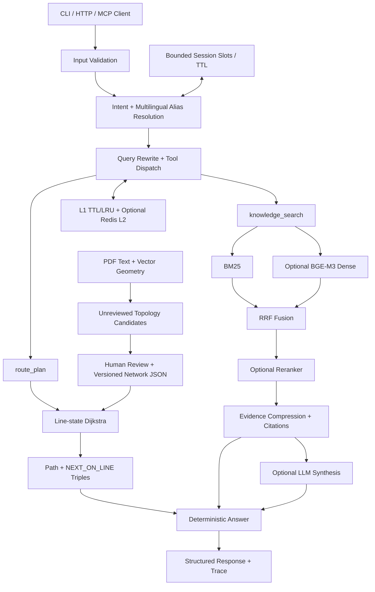

<div align="center">

# MTR Polyglot Agent

**香港地铁多语言问答 · Evidence-grounded RAG · Line-aware Graph Reasoning**

面向中英粤混合输入的 Agent 工程实践：从意图与上下文，到知识检索、路线推理、工具协议和可复现评测。

[](https://github.com/rryyyi/Agent-Project-3/actions/workflows/ci.yml)
[](pyproject.toml)
[](LICENSE)
[](src/mtr_agent/mcp_server.py)

[快速开始](#快速开始) · [系统架构](#系统架构) · [评测与性能](#评测与性能) · [技术阅读路线](docs/interview.md) · [English](README.en.md)

</div>

## 项目定位

这是依据「南京飞衍智能科技有限公司 · Agent 开发工程师 · 2025.08—2025.12」经历中的业务场景独立重建的**公开作品集实现**。它展示如何把多语言理解、Graph RAG 与 Agent 工具编排落成可运行、可测试、可解释的工程。

公开仓库使用原创合成数据，不包含企业内部代码、客户聊天、真实运营日志或简历原件。它不是港铁官方产品，也不代表企业原系统的开源版本。默认提供可复现的离线参考实现；真实模型通过显式配置接入。设计文档、提交记录、测试和运行报告共同构成实现依据。

| 业务问题 | 本仓库的具体实现 | 可审查依据 |
|---|---|---|
| “由 Central 去紅磡点搭”混合语言难以匹配 | 中英粤站点别名、最长匹配、方向槽位、多轮目的地改写 | [understanding.py](src/mtr_agent/understanding.py)、[测试](tests/test_agent.py) |
| 线路顺序和换乘不能仅靠语义相似度 | 将相邻站点关系存为图；以 `(station, line)` 为状态执行 Dijkstra，返回三元组证据 | [routing.py](src/mtr_agent/routing.py)、[测试](tests/test_routing.py) |
| PDF 图形连接承载结构信息 | 提取文字坐标、矢量线段、颜色、页码和文件哈希；输出需审核的连接候选 | [pdf.py](src/mtr_agent/pdf.py)、[数据说明](docs/data.md) |
| RAG 需要可追踪证据 | 带来源的切片、BM25、可选 BGE-M3、RRF、可选交叉编码重排、证据预算 | [retrieval.py](src/mtr_agent/retrieval.py) |
| 工具接入方式容易重复实现 | 同一参数模型与执行层，复用至 HTTP、Function Calling Schema、官方 MCP stdio | [tools.py](src/mtr_agent/tools.py)、[mcp_server.py](src/mtr_agent/mcp_server.py) |
| 多轮、并发和缓存引入状态风险 | TTL/LRU、有界会话、分片锁、数据与模型配置版本键、Redis 故障回退 | [agent.py](src/mtr_agent/agent.py)、[cache.py](src/mtr_agent/cache.py) |
| “效果很好”难以核验 | 样例评测集、精确指标分母、失败样本、独立性能命令、CI | [evaluation.py](src/mtr_agent/evaluation.py)、[评测说明](docs/evaluation.md) |

## 快速开始

需要 Python 3.11+。推荐 Python 3.12；基础演示不需要 GPU、API Key、Redis 或向量数据库。

```bash
git clone https://github.com/rryyyi/Agent-Project-3.git
cd Agent-Project-3
python -m venv .venv
```

激活环境，按操作系统选择一条：

```bash
# macOS / Linux / Git Bash
source .venv/bin/activate
```

```powershell
# Windows PowerShell
.\.venv\Scripts\Activate.ps1
```

```bash
python -m pip install -e ".[dev,mcp,redis]"
mtr-agent demo
mtr-agent chat "由Central去紅磡點搭？"
mtr-agent evaluate --output artifacts/evaluation.json
python -m pytest -q
```

只运行 Agent 可以安装 `python -m pip install -e .`；开发工具、MCP 和 Redis 均为可选 extra。上述“无需外部依赖”指运行阶段；首次安装仍需下载 Python 包。

### 一次真实工具调用会返回什么

```bash
mtr-agent chat "由Central去紅磡點搭？"
```

响应核心字段如下，省略请求 ID、耗时和完整三元组：

```json
{
  "intent": "route",
  "rewritten_query": "route CEN -> HUH; objective=fastest",
  "status": "answered",
  "mode": "offline",
  "route": {
    "stations": ["CEN", "ADM", "EXC", "HUH"],
    "transfers": 1,
    "transfer_stations": ["ADM"],
    "minutes": 15
  },
  "citations": [{"source": "SYNTHETIC-NETWORK-v1: manually authored educational topology; not operational data", "version": "synthetic-hk-2026-01"}]
}
```

`15` 分钟来自**合成边权 + 合成换乘成本**，不代表真实行程时间。API 返回值保留这一声明。

| 输入 | 预期行为 |
|---|---|
| `How to get from Central to Hung Hom?` | 英文路线表达，正确识别起终点 |
| `to Central from Hung Hom` | 按方向标记识别红磡 → 中环 |
| `HKU去尖沙咀最少换乘` | 切换到最少换乘目标 |
| 同一会话：`Central去尖沙咀` → `咁去旺角呢？` | 保留中环起点，更新终点为旺角 |
| `Octopus payment 點用？` | 返回 FAQ 原文及文档、页码引用 |
| `Central去Airport` | 样例网络不含机场，要求澄清 |
| `Central去紅磡尾班車幾點` | 进入营运信息边界说明，不编造尾班时间 |
| `quantum banana weather` | 无证据，返回 `unsupported` |

单次 CLI `chat` 的进程结束后不保存会话；多轮演示请使用 `demo`、Python API 或常驻 HTTP 服务。

## 系统架构



路线问题使用**图查询与工具推理**；FAQ 使用**文本检索与证据回答**。图中的站序是拓扑相邻关系，乘车分钟是独立人工样例权重，真实时间表需要另外的数据源。默认不让 LLM 自行算路线。

完整设计与取舍见 [架构文档](docs/architecture.md)。

## 关键实现

### 1. 中英粤输入与 Query 改写

- 站点词表包含繁简中文、英文、缩写和常见别名，例如 `中環 / 中环 / Central`。
- 最长别名优先，防止把 `旺角東 / Mong Kok East` 误识别成旺角。
- 英文别名使用字母数字边界，避免在 `centralized` 中匹配 `Central`。
- 将自然语言槽位改写为 `route CEN -> HUH; objective=fastest`，减少后续工具歧义。
- 单会话只保存起终点，不保存完整聊天；“咁去旺角呢”复用起点，无法确定的否定、多目的地、未知站点触发澄清。

默认意图层是**可审查的规则基线**，不声称具备通用中英粤语义理解能力。BGE-M3 用于可选语义检索，不替代意图分类器；更复杂的语义解析需增加模型槽位抽取与独立评测。

### 2. 图检索与多跳推理

图边表示 `A --NEXT_ON_LINE(line)--> B`，在双向邻接中查询。搜索状态为 `(站点, 当前线路)`，更换线路时加换乘成本；同一站点不同线路属于不同状态。

- `fastest`：优先最小总合成分钟，再比较换乘次数。
- `fewest_transfers`：优先最少换乘，再比较总合成分钟。
- 输出逐段线路、站序、换乘站、三元组、来源和数据版本。
- 显式处理同站、未知站、无路可达和非法图结构。

这是有界网络上的 Graph RAG 参考实现，没有引入全局社区摘要、图数据库或通用知识图谱问答。小规模数据使用邻接表，比额外部署图数据库更利于直接复现。

### 3. 检索与压缩

默认流程为 `切片 → 中文字符/二元词与英文词 BM25 → RRF → 字符预算压缩`。开启模型后增加 BGE-M3 的 dense 分支与交叉编码 Reranker。

切片保留 `document_id / chunk_id / source / page`；上下文压缩是**抽取式字符预算**，默认最多 1,600 字符，不是 tokenizer token 数的精确保证。Dense 相似度阈值 `0.5` 为演示默认值，需要在独立数据上调优。

### 4. 工具协议、缓存与故障行为

- 参数通过 Pydantic 校验，同一个工具注册表复用到不同传输方式。
- 缓存仅存无状态工具结果；键包含知识内容哈希、检索配置与规范化参数。
- L1 默认最多 256 项、TTL 120 秒；Redis L2 为可选项，连接超时后回退本地。
- 会话默认最多 256 个、TTL 30 分钟；分片锁防止同一会话并发修改槽位。
- 可选 LLM 仅整理 FAQ 证据；失败时回退原文。提示词约束与引用不构成幻觉正确性保证，关键业务应继续使用抽取式输出或增加独立事实校验。

## HTTP API 与多轮对话

```bash
mtr-agent serve --host 127.0.0.1 --port 8000
```

交互文档：`http://127.0.0.1:8000/docs`。

```bash
curl -X POST http://127.0.0.1:8000/v1/chat \
  -H "Content-Type: application/json" \
  -d '{"message":"Central去尖沙咀","session_id":"demo-user"}'

curl -X POST http://127.0.0.1:8000/v1/chat \
  -H "Content-Type: application/json" \
  -d '{"message":"咁去旺角呢？","session_id":"demo-user"}'
```

| 方法 | 路径 | 功能 |
|---|---|---|
| GET | `/health` | 进程存活，认证开启后仍公开 |
| GET | `/ready` | 数据版本与运行模式 |
| POST | `/v1/chat` | 问答、会话槽位、工具轨迹与引用 |
| DELETE | `/v1/sessions/{session_id}` | 删除会话状态 |
| GET | `/v1/tools` | Function Calling JSON Schema |
| POST | `/v1/tools/route_plan` | 路线工具 |
| POST | `/v1/tools/knowledge_search` | 证据工具 |
| GET | `/metrics` | 进程内聚合指标，无用户消息 |

`message` 长度为 1—2,000 字符，拒绝空白；会话 ID 最多 64 位，仅允许字母、数字、下划线和短横线。HTTP 响应含 `X-Request-ID`，问答体使用相同 ID。

配置 `MTR_API_KEY` 后除 `/health` 外均要求 `Authorization: Bearer <key>`。这是单租户演示认证；session ID 不是多租户权限边界。部署到公网前请阅读 [部署指南](docs/deployment.md)，落实用户身份、资源归属、网关限流与请求体限制。

## Function Calling 与 MCP

Function Calling 接入点提供工具 Schema 和执行器，**默认 Agent 没有运行 LLM function-calling 循环**；它使用确定性路由选择工具。需要模型自主选工具时，可由客户端把 Schema 传给模型，再将模型的工具参数交给本执行层。

```python
from mtr_agent.tools import Tools

tools = Tools()
function_schemas = tools.schemas()
result = tools.call("route_plan", {
    "origin": "Central",
    "destination": "Hung Hom",
    "objective": "fewest_transfers",
})
print(result["result"]["triples"])
```

官方 MCP Python SDK stdio：

```bash
python -m pip install -e ".[mcp]"
mtr-agent mcp
```

MCP 客户端示例配置，路径替换为本机虚拟环境可执行文件：

```json
{
  "mcpServers": {
    "mtr-polyglot": {
      "command": "/absolute/path/Agent-Project-3/.venv/bin/mtr-agent",
      "args": ["mcp"]
    }
  }
}
```

Windows 使用 `C:/.../Agent-Project-3/.venv/Scripts/mtr-agent.exe`。stdio 的 stdout 专用于 JSON-RPC，不应由启动脚本打印横幅。MCP 入口只开放 `route_plan`、`knowledge_search`。

## PDF 路线图解析

```bash
mtr-agent parse-pdf /path/to/authorized-route-map.pdf \
  --output artifacts/map-candidates.json
```

流程：`文字行与边界框 → 矢量线段与颜色 → 端点邻近站名候选 → 人工核对 → 版本化 network.json → 图搜索`。

输出包含页码、坐标、线段颜色/宽度、PDF SHA-256、候选端点与距离，所有候选标记 `unreviewed`。它是可解释的几何基线：曲线、复杂交叉、跨页连接、偏移标注或未知站名可能无法正确连接；扫描件仅标记 `needs_ocr`。这里没有自动 OCR、视觉语言模型或自动审核发布功能，也不从连线推测真实运行时间。

测试使用运行时生成的原创矢量 PDF，确保坐标与候选连接确实经过解析。详细审核步骤和数据格式见 [数据文档](docs/data.md)。

## 可选真实模型

```bash
python -m pip install -e ".[models]"
```

```bash
# macOS / Linux / Git Bash；Windows PowerShell 使用 $env:NAME="value"
export MTR_DENSE_MODEL=BAAI/bge-m3
export MTR_RERANK_MODEL=BAAI/bge-reranker-v2-m3
export MTR_MODEL_DEVICE=cpu
mtr-agent chat "How can I pay with an Octopus card?"
```

可选 LLM 证据整理：

```bash
export LLM_BASE_URL=https://your-provider.example/v1
export LLM_MODEL=your-model
export LLM_API_KEY=your-private-key
mtr-agent chat "Octopus payment 點用？"
```

模型不会在默认启动时下载。BGE-M3 在本实现中使用 SentenceTransformers 的 **dense embedding**，不包含模型原生 sparse/ColBERT 分支。模型配置下的质量与延迟需要重新测量；仓库离线报告不代表模型模式结果。LLM 接入使用兼容 OpenAI 的 HTTP 接口，20 秒读取超时，失败回退证据原文。

`.env.example` 是配置模板；CLI 只读取已导出的环境变量，不自动加载 `.env`。模型缓存、硬件、第三方模型许可和外部数据传输说明见 [模型指南](docs/models.md)。

## 评测与性能

```bash
mtr-agent evaluate --output artifacts/evaluation.json
mtr-agent benchmark --iterations 500 --concurrency 8 --output artifacts/benchmark.json
python -m pytest --cov=mtr_agent --cov-report=term-missing
ruff check src tests
ruff format --check src tests
```

提交在 [docs/reports](docs/reports) 的结果是指定环境的一次本地运行快照，以 JSON 中的日期、配置和指标为准；可使用相同命令复跑。评测集包含 **36 条人工编写的合成回归用例**，覆盖混合语言、方向、换乘、多轮、澄清、证据和拒答，未作为盲测业务集。

本地验证（Windows / Python 3.14.4 / 离线）：**44 项测试通过，源码覆盖率约 89%**；36/36 意图与状态匹配、13/13 目标文档 Hit@3、13/13 路线标注字段匹配。小型回归集上的满分仅表示这些已知用例符合预期。500 次、8 线程暖缓存进程内测量：P50 **0.254 ms**、P95 **0.469 ms**、P99 **47.070 ms**；尾延迟包含线程调度与争用，不将其外推为线上性能。详见 [验证记录](docs/reports/verification.md)。

| 指标 | 定义 | 解释边界 |
|---|---|---|
| Intent accuracy | 正确意图数 / 全部问句数 | 两类路由意图：route / knowledge；澄清由 status 体现 |
| Status accuracy | 正确回答状态数 / 全部问句数 | answered / clarification / unsupported |
| Retrieval Hit@3 | 目标文档出现在前 3 条证据的用例数 / 有文档标注的用例数 | 不是全量相关文档召回率，也不是答案正确率 |
| Route exact match | 所有显式预期字段匹配的路线用例数 / 有路线标注的用例数 | 部分用例只标起终点；不等于全部路径字段一致 |
| P50 / P95 / P99 | 暖缓存、进程内、离线调用耗时分位数 | 不含 HTTP、网络、模型推理，不能据此宣称线上容量 |

简历中提到的“意图 89%、检索 78%→91%、复杂问题 92%”属于原经历的业务指标叙述，**本仓库未获得原测试集、统计口径或线上日志，未验证或复现这些数值**。此处的公开测试与评测单独报告，不将二者混用。如何增加盲测集、进行消融与负载测试见 [评测指南](docs/evaluation.md)。

## Docker

```bash
docker compose up --build
```

默认仅监听宿主机 `127.0.0.1:8000`，容器以非 root 身份运行。可选 Redis：

```bash
# 先复制 .env.example 为 .env，并设置：
# REDIS_URL=redis://redis:6379/0
# MTR_API_KEY=your-generated-key
docker compose --profile redis up --build
```

Compose 只映射基础 API/Redis 环境变量；模型部署需要扩展镜像、显式传入模型配置并挂载缓存。当前会话状态与指标均在单进程内，多进程不共享。完整部署约束见 [部署文档](docs/deployment.md)。

## 目录与阅读路线

```text
src/mtr_agent/
├── agent.py          # 有界编排、会话槽位、证据回答、Trace
├── understanding.py  # 可检查的规则意图与方向/上下文改写
├── routing.py        # 线路状态 Dijkstra、多跳三元组
├── retrieval.py      # 切片、BM25、RRF、字符预算
├── adapters.py       # BGE-M3 / Reranker / LLM 可选适配
├── tools.py          # 工具 Schema、参数验证、缓存身份
├── cache.py          # TTL/LRU + Redis L2 回退
├── api.py            # HTTP、认证、并发准入、指标
├── mcp_server.py     # 官方 MCP SDK stdio
├── pdf.py            # PDF 几何证据与待审候选
├── factory.py        # 显式环境配置接线
├── evaluation.py     # 指标、失败样本与性能测量
├── cli.py            # 演示 / 服务 / 评测 / 解析命令
└── data/             # 合成网络、FAQ、回归用例
```

- **5 分钟运行**：快速开始 → `demo` → API `/docs`。
- **15 分钟架构审查**：[架构](docs/architecture.md) → `agent.py` → `routing.py` → `tools.py`。
- **质量与效果审查**：[评测](docs/evaluation.md) → `tests/` → `docs/reports/`。
- **深入技术交流**：[技术阅读与面试索引](docs/interview.md)。

## 已知边界与后续方向

当前网络仅含 15 个站点、3 条线路的局部合成拓扑与 5 篇 FAQ；中文字符基线没有语言模型的泛化能力。BGE-M3 接入使用内存暴力余弦检索，适合演示，不适合大规模索引。向量 ANN、生产认证、共享会话存储、实时运营数据、OCR/VLM 和开放域意图抽取均应作为独立能力增加，再做专项验证。

CI 覆盖 Python 3.11/3.12/3.13 的 lint、测试、评测与包构建，并提供容器构建任务；[首次发布验证](https://github.com/rryyyi/Agent-Project-3/actions/runs/45541417193) 的三个 Python 版本和 Linux 容器构建/运行已全部通过。徽章展示最新 GitHub 实际运行状态。依赖更新由 Dependabot 提交，改动通过 PR 模板说明目的与验证。欢迎按 [贡献指南](CONTRIBUTING.md) 提交可复现问题；安全问题参见 [SECURITY.md](SECURITY.md)。

## 许可与资料

原创代码与原创合成样例按 [MIT](LICENSE) 授权。第三方模型和库遵守各自许可，不随本仓库重新授权。港铁名称仅用于场景说明；真实乘车信息请以 [港铁官方网站](https://www.mtr.com.hk/) 为准，该网站不是本仓库合成数据的采集来源。
