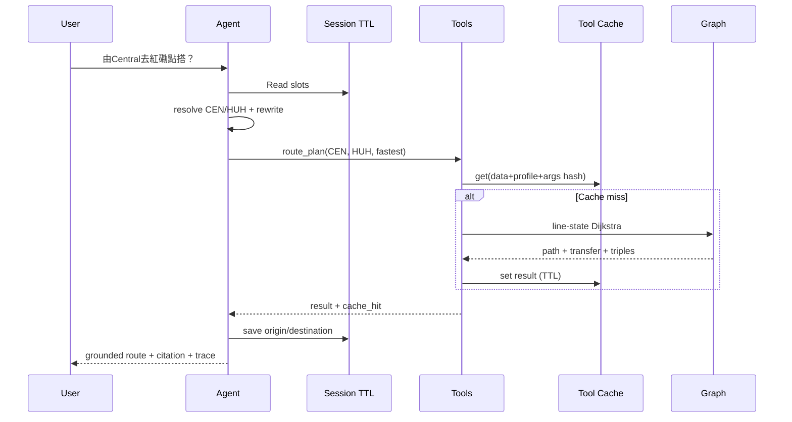

# 架构与工程取舍

## 约束驱动的设计

招聘方应在没有密钥、GPU、向量数据库的环境下运行项目。因此默认采用确定性编排、邻接表图搜索和本地 BM25；模型适配器只在显式配置后加载。核心回答在生成前已经有可审查的工具结果，模型不是正确性的唯一来源。

本实现把 Agent 定义为：理解请求与上下文，选择受约束工具，执行并收集证据，根据证据回答并输出轨迹。默认控制流是有界的固定工作流，每个问题至多调用一个路线/检索工具，没有无限自治循环。这比为双工具场景引入复杂多 Agent 框架更便于验证。接入 LLM 自主工具选择是扩展点，不是当前已实现能力。

## 模块契约

| 模块 | 输入 | 输出 | 主要约束 |
|---|---|---|---|
| Knowledge | Network JSON + FAQ | 校验网络、站点、内容哈希 | 引用合法、边权为正、站点 ID 唯一 |
| Understanding | 用户文字 + 起终点槽位 | intent / slots / query / clarification | 长别名优先、有限语法、拒绝不明路线 |
| Tools | 工具名 + JSON 参数 | result + cache_hit | 固定注册表、Pydantic 拒绝额外字段 |
| Router | 起终点 ID + objective | 路段、站序、换乘、三元组 | 状态含线路、边权非负、无实时承诺 |
| Retriever | query + limit | 含文档/页码的 evidence | 预算、阈值、空证据显式返回 |
| Agent | message + session ID | 回答、证据、轨迹、状态 | 输入有界、会话 TTL、无原始聊天持久化 |
| HTTP / MCP | 传输参数 | 统一工具结果 | HTTP 不直接执行用户提供的代码或文件 |

## 典型请求序列

## 图查询为何需要线路状态

若只把“站点”当状态，到达换乘站时无法知道是否需要换乘。这里搜索 `(station, line)`，边从当前站到相邻站；当前线路非空且改变时才增加换乘次数和换乘分钟。第一次上车不是换乘。中环—金钟的样例连接同时属于两条线，算法可以保留同线状态，避免虚构换乘。

`fastest` 代价是 `(minutes, transfers)`，`fewest_transfers` 是 `(transfers, minutes)`，使用元组字典序比较。代价每项非负，Dijkstra 的前提成立。图规模为 V 站、L 线、E 连接时，展开状态数受站线关联数约束；搜索复杂度约为 `O(E' log V')`。本项目 15 站无需图数据库。

每条访问边映射为 `NEXT_ON_LINE` 三元组并附 line/source。`minutes` 是独立合成属性，拓扑方向与车次时间顺序不能互相替代。相同起终点返回 0 分钟、0 换乘。

## 检索流水线

1. 原文按 400 字符切片、重叠 60 字符，保留文档和页码。
2. 英文词、中文字符与二元词用于 BM25。默认相关性门槛阻止只命中单个常见汉字的弱匹配；它仍是启发式基线。
3. 可选 dense 分支提前编码文档，查询时余弦相似度过滤，默认阈值 0.5。
4. 两个分支各保留最多 10 个候选；RRF `sum(1/(60+rank))` 融合，避免直接相加不同尺度的分数。
5. 可选交叉编码 Reranker，对融合候选逐对打分。
6. 取前 k、按字符预算抽取压缩，引用不脱离证据。

内存 dense 检索为线性扫描；文档增多应以向量索引替换，不需要改变 Tools 接口。检索分数不是已校准的置信度。

## 状态、缓存和并发

会话仅保存 `{origin, destination}`，最多 256 会话，默认闲置 TTL 1,800 秒，读取/写入由锁保护。64 个分片锁让同一会话的完整 turn 串行，避免读后写竞态；不同会话可能哈希到同一分片而短暂串行，这是内存可控与吞吐之间的取舍。

工具结果是公开合成知识上的无状态运算，适合跨会话缓存。L1 最多 256 项、TTL 120 秒、LRU 淘汰；返回深拷贝，调用方修改不会污染缓存。L2 Redis 是可选的，每次连接/读取超时 0.3 秒；不可用时退回 L1 和正常计算。无分布式 single-flight，Redis 断连或缓存击穿下可能发生重复计算，不能据此宣称具备生产级高并发保障。

键由“知识内容哈希 + 检索配置 + 工具名 + 规范化参数”生成。模型修订、Prompt、切片规则变动时需同步修改 profile 版本；上线应把模型 commit 和索引版本纳入发布配置。上下文回答本身不放入共享工具缓存。

## 轨迹与运维

响应 trace 含步骤、意图、工具名、缓存命中、证据数量、耗时、兜底原因；日志只记录请求 ID/状态或脱敏失败事件，不记录完整聊天、模型响应或密钥。HTTP `/metrics` 是进程内轻量聚合文本：请求数、总耗时、会话数、Redis 错误数。不是完整 OpenTelemetry/Prometheus 分布式观测平台。

HTTP 有单进程最大 32 个并发请求的准入保护，超出返回 503；这不是每用户速率限制。部署应增加网关限流、上游超时、实际请求体大小限制与用户授权。详见 [部署文档](deployment.md)。

## 故障语义

- 数据结构非法：启动失败，避免带错误拓扑服务。
- 站点/方向不明：clarification，不复用不确定槽位。
- 图中不可达：unsupported。
- 无相关知识：unsupported，不调用 LLM 猜测。
- LLM 异常：保留引用，回退抽取式证据。
- Redis 异常：记录计数，继续本地计算。
- PDF 格式不合法或过大：明确拒绝；扫描页只标记 OCR 需求。
- 跨进程/重启：当前会话与指标不持久化，不提供恢复保证。
